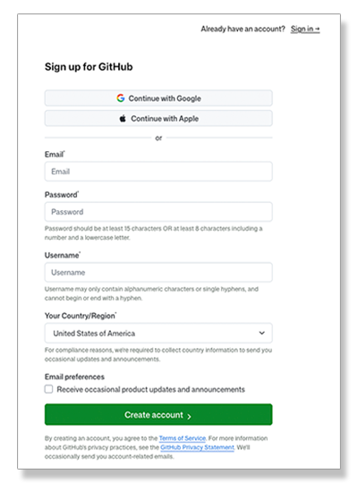
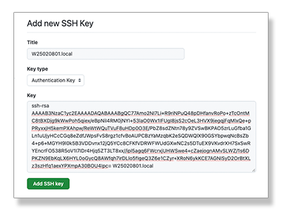

# Essential Git

You are participating in a Hackathon and told the project must be published to a Git respository in order to share it with the judges.
Or perhaps there are is a new requirement to publish to share a project with teammates or stakeholders.
What is this?
How do you do accomplish it?

**Git** is a *distributed version control system*.
A *Git repository* is a project folder that keeps a complete history of every saved version of its files, so you can see what changed, who changed it, and go back to any earlier version at any time.
The *distributed* part is that multiple copies of the repository may be kept in sync across multiple computers.

**GitHub** (Microsoft), **GitLab**, **BitBucket** (Atlasian), and **Azure DevOps** (Microsoft) are the major service
providers offering *Git hosting services*, with GitHub having the largest collection of repositories by far.
Estimates based on 2025 survey data from Stack Overflow:


GitHub and GitLab offer fully free levels for public and private repositories for personal use,
as well as private serivces for enterprises.
GitHub will be used as the service provider for the following instructions.

Considering that the publishing must take place the next step is to leverage the power of Git for the team to develop
the project.
Individuals can work on various aspects or "features" of the project, and the work may be integrated into the share
repository at GitHub.

Table of contents:

1. [Creating a GitHub Personal Account](#creating-a-github-personal-account)
1. [Creating a GitHub Project](#creating-a-github-project)
1. [Install Git Locally](#installing-git-locally)
1. [Configure Git](#configure-git)
1. [Defining a Local Repository](#defining-a-local-repository)
1. [Publishing the Project to GitHub](#publishing-the-project-to-github)
1. [Working as a Team](#working-as-a-team)

## Creating a GitHub Personal Account

One person must own the project at GitHub and will need a *Personal Account*.
If Git will be used for project development, everyone working together will also need their own GitHub account
in order to access the project repository.

<table>
<tr>
<td></td>
<td>
<ol>
<li>Visit https://github.com and click on the "Sign up" button.</li>
<li>Avoid creating an account with social media. If you lose the social media account you may lose everything at GitHub.</li>
<li>Provide a valid email addres, it cannot previously be used at GitHub.
<li>Create a password.</li>
<li>GitHub requires a unique username which becomes part of the repository URIs.</li>
<li>Pick your country/region and create the account.</li>
<li>You will have to set up multi-factor authentication, GitHub requires it.</li>
<li>Once the account is created and you are logged in, click on your avatar at the upper right and click on "Settings".</li>
<li>At the left of the settings page the section "Passwords and authentication" is wher eyou can manage "Sign in" methods,
including multi-factor authentcation.
<li>On the settings page at the left select "Emails", and add a second email so you can recover the account with it.</li>
</ol>
</td>
</tr>
</table>

### SSH keys

GitHub no longer allows passwords for authentication when uploading commits to the remote repository.
There are three solutions, but using SSH (Secure Shell) public/private key-pairs is the easiest solution to work with.

Best practices:
* Use a separate SSH key-pair for each remote service, including Git hosting services.
    If the key for any service is compromised, it does not affect any other service.
* Do not copy and use the keys across multiple computers.
    If any computer is compromised all the keys would be compromised.

#### Create a local SSH key

Create a unique SSH key to use with GitHub.
The `ssh-keygen` program is installed by default on Microsoft Windows, Apple macOS, and Linux.
Save the key as *-github* in the *.ssh* folder in your home directory (represented in this example with a ~).
In Windows PowerShell replace the *~* with *$HOME*.

```ps1
$ ssh-keygen -t ed25519 -f "~/.ssh/id_ed25519_github" -C "<your_computer_name>"
```

Note that this command ignores the recommedation of GitHub and other services.
Most instructions assume that the key file name will be the default 'id_ed25519',
and specifiy you should put your email address as the *comment*, but
this is contrary to best security practices.
Unless you are only using one service with SSH the default key should not be used.
The key file name should include the name of the remote service, so that you can identify a key-pair that was compromised if
a service was compromised and remove it.
The comment should be the local computer name, since each computer should have its own unique keys.
The comment is recorded on the remote service, when it has the computer name
you can isolate and remove at the service the just the one key for a compromised computer.

#### Install the public key at GitHub

<table>
<tr>
<td></td>
<td>
<ol>
<li>Locate the public key file.
    It is in the ~/.ssh folder and has the same name as the key file with the *.pub* extension.
    ~ represents your home directory.</li>
<li>While logged into the GitHub account, click on your avatar at the upper right and select "Settings" from the menu.</li>
<li>From the menu on the left of the <i>Settings</i> page select <i>SSH and GPG keys</i>.</li>
<li>Click the "New SSH key" button at the upper left.</li>
<li>Copy the contents of the public key file from step 1 and paste it into the <i>Key</i> field in the form.</li>
<li>Set the <i>Title</i> field to match the comment at the end of the data in the <i>Key</i> field.</li>
<li>Click the <i>Add SSH key<i> button at the lower left of the form to add the new key.</li>
</ol>
</td>
</tr>
</table>

## Creating a GitHub Project

On 

### Sharing the project with team members


## Install Git locally

### Microsoft Windows

Run the following command in PowerShell ($ is the command prompt):

```ps1
$ winget install --id Git.Git -e --source winget
```

### Apple macOS

`git` is a stub; running git at the command line will trigger `xcode-select install` to install the xcode command line tools.

```zsh
$ git
```

1. In the dialog box that opens click the *Install* button.
1. Agree to the license.
1. Wait for the download and installation to finish.
1. Click the done button.

### Debian (Ubuntu) Linux

```bash
$ sudo apt update
$ sudo apt install git
```

## Configure Git

Git records the *author* (user name) and *email address* attributes in each "commit" of changes to the local repository.
The Git hosting service may or may not require known authors and email addresses.
As an enterprise service Bitbucket is generally configured to refuse commits that are recorded with an author
or email that does not match a user account.
GitHub for personal accounts generally allows any value and simply uses it when displaying the repository history.

Run these two commands to set the attributes Git will use with the information that matches your account:

```ps1
$ git config --global user.name "<your name>"
$ git config --global user.email "<your email address>"
```

## Defining a local repository

### Initializing the repository

The local git repository may be created at any time, before or after project files have been created.
This needs to be done by the user who creates 

### Cloning a GitHub repository

### Staging and/or ignoring files

### Committing changes

#### Set up git so the base command uses the specific key

```ps1
$ git config --global core.sshCommand "ssh -i ~/.ssh/id_ed25519_github -o IdentitiesOnly=yes"
```

## Publishing the Project to GitHub


## Working as a team

### Feature branches

### Merge conflicts

### Pull pequests at GitHub