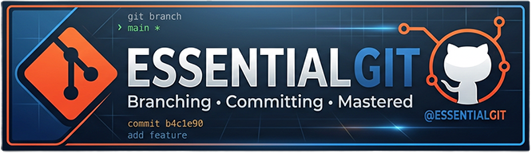
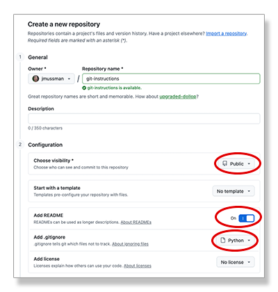
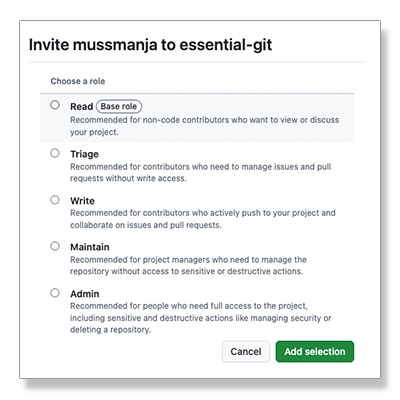
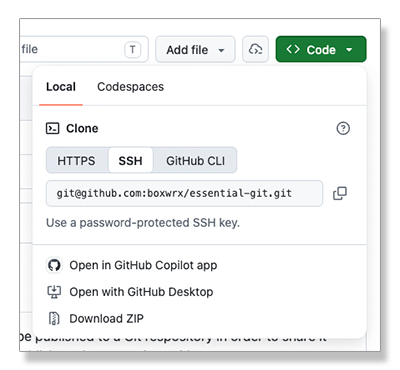

[//]: # (README.md)
[//]: # (Copyright © 2026 Joel A Mussman. All rights reserved.)
[//]: #



<div align="right">
    Provided by <a href="https://github.com/boxwrx">Box Works</a> Coding Environments 
    
</div>
<br>

You are participating in a Hackathon and told the project must be published to a cloud-service
Git respository in order to share it with the judges.
Or perhaps there are is a new requirement to publish to share a project with teammates or stakeholders.
What is this?
How do you do accomplish it?

**Git** is a *distributed version control system*.
A *Git repository* is a project folder that keeps a complete history of every saved version of its files, so you can see what changed, who changed it, and go back to any earlier version at any time.
The *distributed* part is that multiple copies of the repository may be kept in sync across multiple computers.

**GitHub** (Microsoft), **GitLab**, **BitBucket** (Atlasian), and **Azure DevOps** (Microsoft) are the major service
providers offering *Git hosting services*, with GitHub having the largest collection of repositories by far.
Estimates based on 2025 survey data from Stack Overflow:


GitHub and GitLab offer fully free levels for public and private repositories for personal use,
as well as private serivces for enterprises.
GitHub will be used as the service provider for the following instructions.

Considering that the publishing must take place the next step is to leverage the power of Git for the team to develop
the project.
Individuals can work on various aspects or "features" of the project, and the work may be integrated into the share
repository at GitHub.

These instructions are purposely written to use Git on the command line.
If you understand what needs to be done then it is simple to map that to what the buttons
in an integrated development environment (IDE) will do.

Table of contents:

1. [Create a GitHub Personal Account](#create-a-github-personal-account)
1. [Create a GitHub Project](#create-a-github-project)
1. [Install Git Locally](#install-git-locally)
1. [Configure Git](#configure-git)
1. [Work Locally](#work-locally)
1. [Publish to GitHub](#publish-to-github)
1. [Work as a Team](#work-as-a-team)

## Create a GitHub Personal Account

One person must own the project at GitHub and will need a *Personal Account*.
If Git will be used for project development, everyone working together will also need their own GitHub account
in order to access the project repository.

<table>
<tr>
<td></td>
<td>
<ol>
<li>Visit https://github.com and click on the "Sign up" button.</li>
<li>Avoid creating an account with social media. If you lose the social media account you may lose everything at GitHub.</li>
<li>Provide a valid email addres, it cannot previously be used at GitHub.
<li>Create a password.</li>
<li>GitHub requires a unique username which becomes part of the repository URIs.</li>
<li>Pick your country/region and create the account.</li>
<li>You will have to set up multi-factor authentication, GitHub requires it.</li>
<li>Once the account is created and you are logged in, click on your avatar at the upper right and click on "Settings".</li>
<li>At the left of the settings page the section "Passwords and authentication" is wher eyou can manage "Sign in" methods,
including multi-factor authentcation.
<li>On the settings page at the left select "Emails", and add a second email so you can recover the account with it.</li>
</ol>
</td>
</tr>
</table>

### SSH keys

GitHub no longer allows passwords for authentication when uploading commits to the remote repository.
There are three solutions, but using SSH (Secure Shell) public/private key-pairs is the easiest solution to work with.

Best practices:
* Use a separate SSH key-pair for each remote service, including Git hosting services.
    If the key for any service is compromised, it does not affect any other service.
* Do not copy and use the keys across multiple computers.
    If any computer is compromised all the keys would be compromised.

#### Create a local SSH key

Create a unique SSH key to use with GitHub.
The `ssh-keygen` program is installed by default on Microsoft Windows, Apple macOS, and Linux.
Save the key as *-github* in the *.ssh* folder in your home directory (represented in this example with a \~).
In Windows PowerShell replace the *\~* with *$HOME*.

```ps1
$ ssh-keygen -t ed25519 -f "~/.ssh/id_ed25519_github" -C "<your_computer_name>"
```

Note that this command ignores the recommedation of GitHub and other services.
Most instructions assume that the key file name will be the default 'id_ed25519',
and specifiy you should put your email address as the *comment*, but
this is contrary to best security practices.
Unless you are only using one service with SSH the default key should not be used.
The key file name should include the name of the remote service, so that you can identify a key-pair that was compromised if
a service was compromised and remove it.
The comment should be the local computer name, since each computer should have its own unique keys.
The comment is recorded on the remote service, when it has the computer name
you can isolate and remove at the service the just the one key for a compromised computer.

#### Install the public key at GitHub

<table>
<tr>
<td></td>
<td>
<ol>
<li>Locate the public key file.
    It is in the ~/.ssh folder and has the same name as the key file with the *.pub* extension.
    ~ represents your home directory.</li>
<li>While logged into the GitHub account, click on your avatar at the upper right and select "Settings" from the menu.</li>
<li>From the menu on the left of the <i>Settings</i> page select <i>SSH and GPG keys</i>.</li>
<li>Click the "New SSH key" button at the upper left.</li>
<li>Copy the contents of the public key file from step 1 and paste it into the <i>Key</i> field in the form.</li>
<li>Set the <i>Title</i> field to match the comment at the end of the data in the <i>Key</i> field.</li>
<li>Click the <i>Add SSH key<i> button at the lower left of the form to add the new key.</li>
</ol>
</td>
</tr>
</table>

## Create a GitHub Project

A team may share a project, but one person must be the owner and create the project.

<table>
<tr>
<td></td>
<td>
<ol>
<li>At the top of every GitHub page is a toolbar.
    Toward the right side of the toolbar look for the <i>+</i> dropdown button.</li>
<li>Click the dropdown and select <i>New Repository</i>.</li>
<li>In the <i>General</i> section enter a unique name for the new repository.</li>
<li>In the <i>Configuration</i> section set the visibility to <i>Public</i>.</li>
<li>Click the button to create a new README file.</li>
<li>Select a .gitignore template that
    matches the development environment you will use (Python?).</li>
<li>At the bottom right of the page click the <i>Create repository</i> button.</li>
</ol>
</td>
</tr>
</table>

### Sharing the project with team members

If you are only interested in publishing the final project for a hackathon you may not be using Git
for development, in which case the project owner will be the only person publishing to GitHub.

If you want to use Git to work as a team, share the project with the other team members.
You will need the GitHub usernames, not the email, of the users you want to add.

<table>
<tr>
<td></td>
<td>
<ol>
<li>At the top of the repository page, below the GitHub toolbar, there is a toolbar
    for the repository.
    The last button at the right is <i>Settings</i>, click it.</li>
<li>In the left menu for the Settings page click on <i>Collaborators and teams</i>.</li>
<li>At the top of the page you can verify that your repository has public visibility.</li>
<li>In the middle of the page under <i>Manage access</i> make sure the <i>Direct access</i> tab is selected.</li>
<li>To the right click the <i>Add people</i></button>.
    One at a time enter usernames and when GitHub resolves the username and shows the avatar, click the
    <i>Invite outside collaborator</i> button to add the user.</li>
<li>Select the <i>Write</i> role so team members can push updates, and click <i>Add member</i>.</li>
<li>Repeat this for each team member.</li>
</ol>
</td>
</tr>
</table>

## Install Git locally

### Microsoft Windows

Run the following command in PowerShell ($ is the command prompt):

```ps1
$ winget install --id Git.Git -e --source winget
```

### Apple macOS

`git` is a stub; running git at the command line will trigger `xcode-select install` to install the xcode command line tools.

```zsh
$ git
```

1. In the dialog box that opens click the *Install* button.
1. Agree to the license.
1. Wait for the download and installation to finish.
1. Click the done button.

### Debian (Ubuntu) Linux

```bash
$ sudo apt update
$ sudo apt install git
```

## Configure Git

Git records the *author* (user name) and *email address* attributes in each "commit" of changes to the local repository.
The Git hosting service may or may not require known authors and email addresses.
As an enterprise service Bitbucket is generally configured to refuse commits that are recorded with an author
or email that does not match a user account.
GitHub for personal accounts generally allows any value and simply uses it when displaying the repository history.

Run these two commands to set the attributes Git will use with the information that matches your account:

```ps1
$ git config --global user.name "<your name>"
$ git config --global user.email "<your email address>"
```

## Work locally

### Set up git so the base command uses the correct SSH key

This command will configure git so it always uses the SSH key that was created above:

```ps1
$ git config --global core.sshCommand "ssh -i ~/.ssh/id_ed25519_github -o IdentitiesOnly=yes"
```

### Initializing the repository

Create a local copy of the repository by cloning the repository from GitHub.
The repository page is visible to everyone at the URL https&ZeroWidthSpace;://github.com/<owner_username>/<repository_name>.
Click the *Code* dropdown button.
Select the *Local* tab.
Pick the *SSH* option, and copy the *git&ZeroWidthSpace;@github.com:...* URI.



Open a terminal window on your computer and choose a directory where you want to work on the project.
The repository will be cloned into a sub-directory at this location.
Use the `git clone` command and provide the URI that was just copied:

```ps1
$ git clone git@github.com:...
```

Open the new folder in the integrated development environment (IDE) you will be using (Visual Studio Code?).

### First steps - work on a branch

Every team member should work on their part of the project on a *feature branch*.
Branches are copies of the project that do not interfere with each other.
Preferabbly name branches after the feature being worked on, alternatively name branches after the team member doing the work.

Open a terminal window in the project folder in your IDE.
Use the `git switch -c <new branch>` command to create a new branch and move on to it (feature1 is an arbitrary name):

```ps1
$ git switch -c feature1
```

### Staging and/or ignoring files

Create files, test code, do whatever work you want on the branch.
The *.gitignore* file contains instructions for Git on files you want to ignore when committing changes to the repository
(never will be added to the repository).
The documentation for the *.gitignore* file is at [https://git-scm.com/docs/gitignore](https://git-scm.com/docs/gitignore).

### Committing changes

Add all the changes to the branch and commit them.
The easy command is `git add --all`, which stages all of the changd files instead of doing them one by one.
And it is easier to add the commit message to the command line with the -m flag instead of letting Git open an editor:

```ps1
$ git add --all
$ git commit -m "<Put a message about the changes here>"
```

### Switching branches

You can always switch between branches, but you really need to stage and commit the changes in the current branch
before moving.
New branches are created with the -c flag, but just use the branch name to switch to an existing branch:

```ps1
$ switch main
$ switch -c feature2
$ switch main
```

You can list branches with `git branch`, the current branch is marked with an asterisk (*):

```ps1
$ git branch
feature1
feature2
* main
```

## Publish to GitHub

You can publish a branch or all branches at the same time from the local computer to GitHub.
The name of the remote repository is stored by default as *origin*.
Your SSH key will be used to authenticate you and if you have write permission on the repository publishing will succeed:

```ps1
$ git push origin <branch_name>
$ git push origin --all
```

If you are the only person working on the project the second command will sync the GitHub repository with what is on
your computer.

## Work as a Team

If team members are working on their own feature branches then they should be pushing commits on just those branches.
Local changes should be staged and committed prior to doing this.
To sync the local repository with what is at GitHub, all branches, use the fetch command:

```ps1
$ git fetch --all --prune
```

### Merging changes from the main branch

Sometimes it is useful to merge any changes on the main branch into a local feature branch.
Very should avoid mergeing changes from another feature branch into your current branch, but it can work if necessary.
Run a `merge` command to merge the changes into the current branch:

```ps1
$ git merge main
```

This may result in merge conflicts, where code in the main branch was changing code your feature branch has already changed...

### Merge conflicts

The secret to avoiding merge conflicts is for everyone to work on their own feature branch, and never touch the files
used by another feature.
Merge conflicts only occur if two branches edit the same file with different results!

If there is a merge conflict, follow these steps:

1. Identify each file that has a merge conflict.
    The IDE can help you with this, usually they are marked in the list of files.
1. Each file with a merge conflict will have markers showing the conflicting changes:
    ```Python
    <<<<<<< HEAD
    print("Hello, everyone!")
    =======
    print("Hello, friends!")
    >>>>>>> friendly
    ````
1. Edit the file to fix the conflicted (choose one or the other, or just change it completely) and remove the markers.
1. Stage the file with `git add <filename>`
1. When all the conflicts are resolved and the files staged, do a `git commit -m <your message>` to fix everything.

### Pull pequests at GitHub

Team members should never try to merge their branches locally with *main*.
The correct path is to make a *pull request* at GitHub, asking for the branch to be merged in the remote repository.

1. On the repo's GitHub page, click the yellow "Compare & pull request" banner, or go to the Pull requests tab
    and click New pull request. 
    check the base branch (where the change goes, usually *main*) and the compare branch (your branch).
1. Give the PR a clear title and explain what changed and why.
    Mention related issues with "Fixes #12" to close them automatically on merge.
    Add reviewers (users to look at the changes)
    on the right if needed, then click Create pull request (or Draft pull request if it's not ready).
1. Reviewers can comment on specific lines, approve, or request changes.
    To respond, keep committing and pushing to the same branch;
    the PR updates automatically.
    Wait for any automated checks to pass.
1. Once approved and with no conflicts, the responsible user (usually the owner) will click *Merge pull request*.
    Choose *Create a merge commit*, *Squash and merge (one tidy commit)*, or *Rebase and merge*.
1. Optionally you may want to click *Delete branch* to clean up by removing the feature banch when the work is done.
1. On all the team members computers each user should commit their work, switch to the main branch with `git switch main`,
    and run a `git pull` to synch their main branch with the remote repository.

## Conclusion

You have a choice of just publishing your work at the end to GitHub for the hackathon judges or to use GitHub as the
tool for managing the project across the team.

In the first case, just merge the final project from the team into the folder that was cloned from GitHub, stage, commit,
and publish the project.

In the second case, after the last pull request and testing the project on the *main* branch, it is ready to be submitted.
